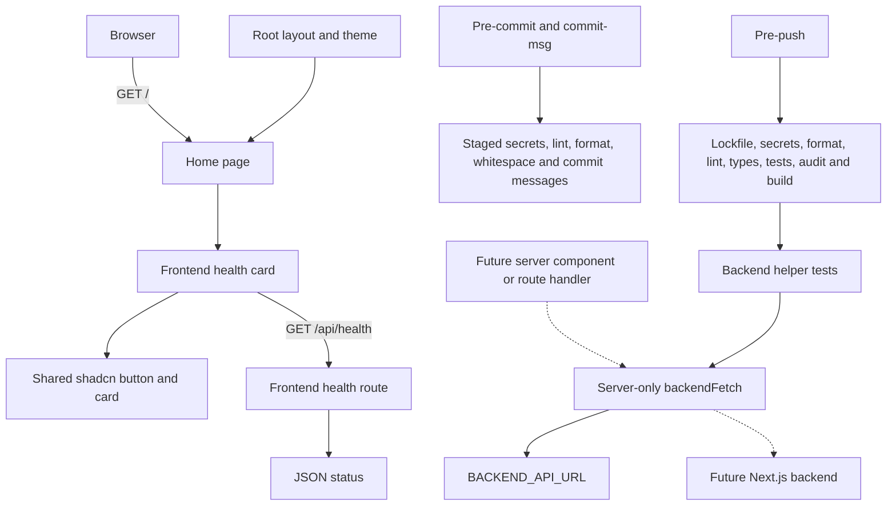

# Application map

Start here to locate change points and follow their dependencies. Update this map alongside feature, route, module, contract, or workflow changes.

## Where to make changes

| Task                                        | Entry point                                                                       | Related code or verification                                                                                                                                   |
| ------------------------------------------- | --------------------------------------------------------------------------------- | -------------------------------------------------------------------------------------------------------------------------------------------------------------- |
| Change `/`                                  | [Home page](<../src/app/(home)/page.tsx>)                                         | [Frontend health card](<../src/app/(home)/_components/frontend-health-card.tsx>)                                                                               |
| Change `/api/health`                        | [GET route handler](../src/app/api/health/route.ts)                               | The [health card](<../src/app/(home)/_components/frontend-health-card.tsx>) links to it. Run the app and check the JSON response.                              |
| Change global layout, breakpoints, or theme | [Root layout](../src/app/layout.tsx) and [global CSS](../src/app/globals.css)     | Inspect affected routes across the changed viewport widths.                                                                                                    |
| Add or update shared UI                     | [Shared primitives](../src/components/ui)                                         | [shadcn configuration](../components.json) and [class-name helper](../src/lib/utils.ts). Existing primitives include button, card, input, label, and skeleton. |
| Connect a backend feature                   | [Backend helper](../src/lib/backend.ts) and [origin placeholder](../.env.example) | Keep endpoint calls, schemas, and tests with their feature. Run the [backend helper tests](../src/lib/backend.test.mjs) with `npm test`.                       |
| Update team or agent rules                  | [Frontend rules](../AGENTS.md)                                                    | [Claude's entry point](../CLAUDE.md) imports the same rules.                                                                                                   |
| Update commit or push verification          | [Hooks](../.husky) and [package scripts](../package.json)                         | [Staged-file configuration](../lint-staged.config.mjs) and [commit-message configuration](../commitlint.config.mjs). Run `npm run verify`.                     |

The frontend currently serves `/` and `/api/health`. Future backend callers will use the server-only helper with the configured origin once endpoint contracts are available.
