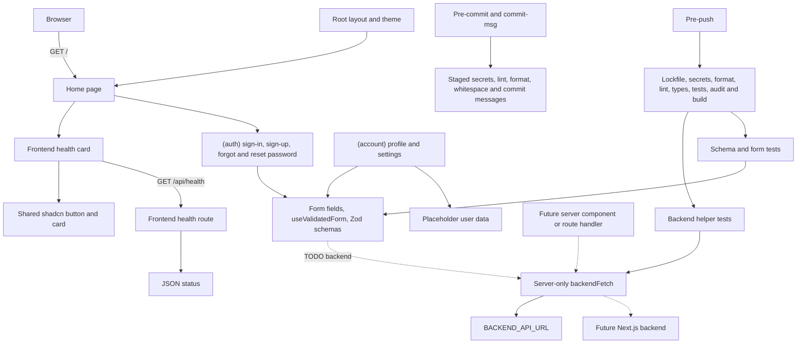

# Application map

Start here to locate change points and follow their dependencies. Update this map alongside feature, route, module, contract, or workflow changes.

## Where to make changes

| Task                                              | Entry point                                                                                         | Related code or verification                                                                                                                                                                                    |
| ------------------------------------------------- | --------------------------------------------------------------------------------------------------- | --------------------------------------------------------------------------------------------------------------------------------------------------------------------------------------------------------------- |
| Change `/`                                        | [Home page](<../src/app/(home)/page.tsx>)                                                           | [Frontend health card](<../src/app/(home)/_components/frontend-health-card.tsx>)                                                                                                                                |
| Change `/api/health`                              | [GET route handler](../src/app/api/health/route.ts)                                                 | The [health card](<../src/app/(home)/_components/frontend-health-card.tsx>) links to it. Run the app and check the JSON response.                                                                               |
| Change global layout, breakpoints, or theme       | [Root layout](../src/app/layout.tsx) and [global CSS](../src/app/globals.css)                       | Inspect affected routes across the changed viewport widths.                                                                                                                                                     |
| Change sign-in, sign-up, forgot or reset password | [Auth pages](<../src/app/(auth)>)                                                                   | Each page keeps its form in `_components`. Rules live in the [shared schemas](../src/lib/auth/schemas.ts); run the [schema tests](../src/lib/auth/schemas.test.mjs) with `npm test`.                            |
| Change profile or settings                        | [Account pages](<../src/app/(account)>)                                                             | Pages show [placeholder data](<../src/app/(account)/_lib/placeholder-user.ts>) until the backend exists.                                                                                                        |
| Connect a form to the backend                     | The form's `onValid` handler, marked `TODO(backend)`                                                | Call a same-origin route handler that uses `backendFetch()`. Return a `FormState` with `fieldErrors` to show backend errors on fields.                                                                          |
| Add or change a form                              | [`useValidatedForm`](../src/hooks/use-validated-form.ts) and [form fields](../src/components/forms) | Fields subscribe with `useFormState` because the React Compiler memoizes them.                                                                                                                                  |
| Change the theme preference                       | [Theme helpers](../src/lib/theme.ts)                                                                | The root layout inlines the init script; the control is on the settings page.                                                                                                                                   |
| Add or update shared UI                           | [Shared primitives](../src/components/ui)                                                           | [shadcn configuration](../components.json) and [class-name helper](../src/lib/utils.ts). Existing primitives include alert, button, card, checkbox, field, input, label, password input, skeleton and textarea. |
| Connect a backend feature                         | [Backend helper](../src/lib/backend.ts) and [origin placeholder](../.env.example)                   | Keep endpoint calls, schemas, and tests with their feature. Run the [backend helper tests](../src/lib/backend.test.mjs) with `npm test`.                                                                        |
| Update team or agent rules                        | [Frontend rules](../AGENTS.md)                                                                      | [Claude's entry point](../CLAUDE.md) imports the same rules.                                                                                                                                                    |
| Update commit or push verification                | [Hooks](../.husky) and [package scripts](../package.json)                                           | [Staged-file configuration](../lint-staged.config.mjs) and [commit-message configuration](../commitlint.config.mjs). Run `npm run verify`.                                                                      |

The frontend serves `/`, `/api/health`, `/sign-in`, `/sign-up`, `/forgot-password`, `/reset-password`, `/profile` and `/settings`. The account pages are UI only and not yet protected. Future backend callers will use the server-only helper with the configured origin once endpoint contracts are available.
